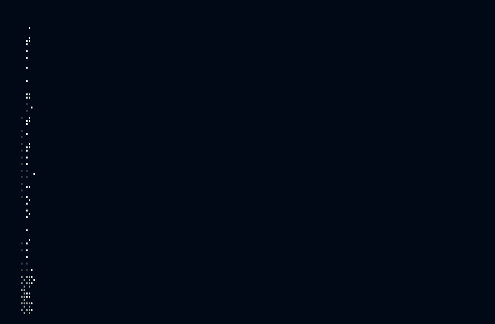

<div align="center">

<!-- Header Banner -->


<!-- Interactive Terminal Animation -->
<a href="https://github.com/DilshanJay4">
  
</a>

<br/>

<!-- Typing Animation -->


<br/>

<!-- Social Links -->
<a href="https://dilshan.sbs">
  
</a>
<a href="https://www.linkedin.com/in/dilshan-jayawardana/">
  
</a>
<a href="https://github.com/DilshanJay4">
  
</a>
<a href="mailto:dilshanjayawardana@gmail.com">
  
</a>

<br/><br/>


</div>

---

## 👨‍💻 About Me

```yaml
name: Dilshan Jayawardana
role: Software Engineer
focus: Backend Engineering & Distributed Systems
interests:
  - Microservices Architecture
  - Event-Driven Systems
  - System Design
  - Cloud Native Engineering
  - Software Craftsmanship
```

---

## `> tech_stack`

<div align="center">
  
</div>

---

## 📊 GitHub Metrics & Activity

<div align="center">
  
</div>

---

<div align="center">

### 🤝 Let's Connect

*Building reliable software, one commit at a time.*

<a href="https://dilshan.sbs">Portfolio</a> ·
<a href="https://www.linkedin.com/in/dilshan-jayawardana/">LinkedIn</a> ·
<a href="mailto:dilshanjayawardana@gmail.com">Email</a>


</div>
